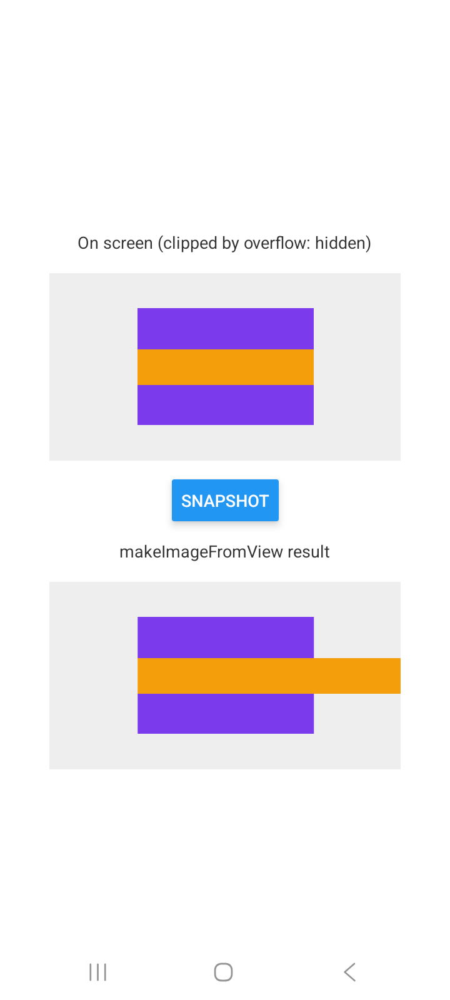

# Expo SDK 57 + @shopify/react-native-skia 2.6.2: `makeImageFromView` skips `overflow: hidden` on Android

Minimal repro for [expo/expo#50701](https://github.com/expo/expo/issues/50701).

A blank `create-expo-app` (SDK 57, `blank-typescript`). The only added dependencies are the ones `npx expo install` picks for SDK 57:

| package | version |
|---|---|
| expo | 57.0.25 |
| react-native | 0.86.3 |
| @shopify/react-native-skia | 2.6.2 (the SDK 57 pin) |
| react-native-reanimated / react-native-worklets | 4.5.1 / 0.10.1 (required by Skia at startup) |

## Steps

```sh
npm install
npx expo run:android --variant release
adb logcat | grep -A3 dispatchOverflowDraw
```

Tap **Snapshot**.

## Expected

The `makeImageFromView` image matches the screen: the orange bar is clipped by its `overflow: 'hidden'` parent (the purple box), and logcat is quiet.

## Actual (Samsung Galaxy A05s, Android 15, release build)



- The snapshot ignores the clip: the orange bar runs past the purple box.
- For every `ReactViewGroup` in the snapshot, logcat prints this, followed by a `java.lang.NoSuchMethodException` stack trace (3 per tap here):

  ```
  E SkiaScreenshot: couldn't invoke dispatchOverflowDraw() on ReactViewGroup
  ```

## Why

In Skia 2.6.2, `ViewScreenshotService.drawChildren` reaches `ReactViewGroup.dispatchOverflowDraw(Canvas)` by reflection, and React Native 0.86 no longer has that method. Skia 2.11.1+ applies `BackgroundStyleApplicator.clipToPaddingBox` instead (see Shopify/react-native-skia#3975). SDK 58 already pins 2.11.2.
